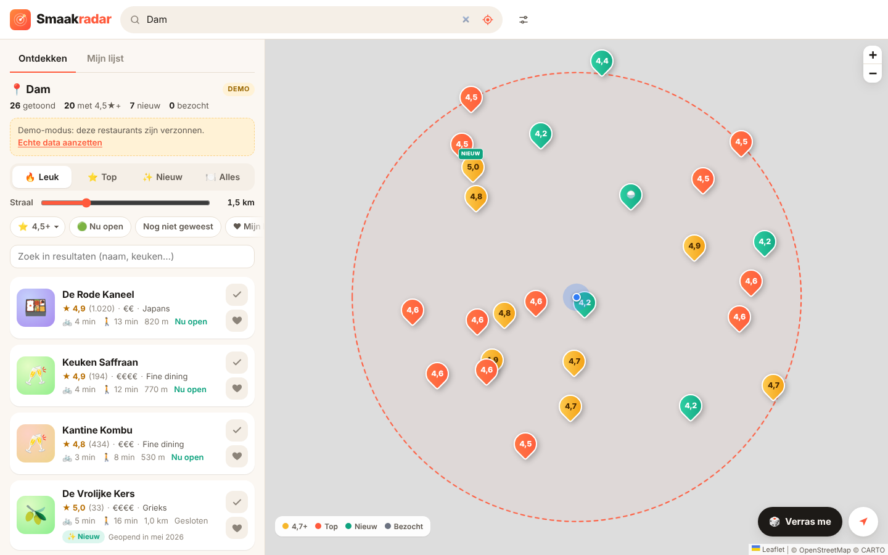
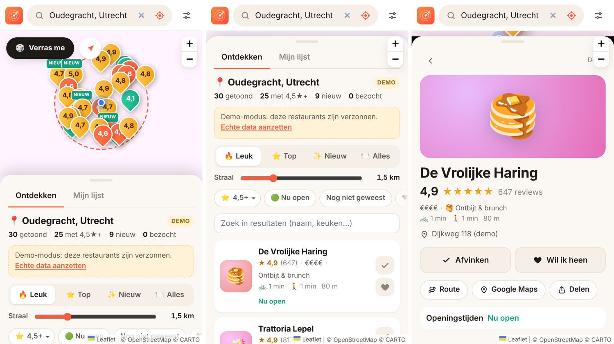

# 🍽️ Smaakradar

Vul je adres in en zie meteen **alle restaurants met 4,5★ of meer** én **de nieuwe zaken** bij jou in de buurt, op een kaart. Vink af waar je bent geweest, geef je eigen sterren en houd een verlanglijstje bij.

Werkt op telefoon, tablet en laptop, en is te installeren als app (PWA).




_Screenshots gemaakt in een testomgeving zonder kaarttegels; in het echt zie je de kaart van CARTO/OpenStreetMap._

## Wat zit erin

| | |
|---|---|
| 📍 **Adres of locatie** | Adressen worden aangevuld terwijl je typt, of je gebruikt je GPS-locatie. Recente zoekopdrachten worden onthouden. |
| ⭐ **Toprestaurants** | Filter op minimale Google-rating (4,0 tot 4,8). De "Beste match" weegt het aantal reviews mee: een 4,9 met 8 reviews is minder zeker dan een 4,7 met 900. |
| ✨ **Nieuw in de buurt** | Combineert signalen: openingsdatum in OpenStreetMap, pas recent op de kaart gezet, en weinig Google-reviews. Elke zaak toont *waarom* hij als nieuw geldt. |
| 🗺️ **Kaart** | Pins met de rating erin: goud bij 4,7+, oranje bij top, groen bij nieuw, grijs als je er al was, plus een hartje voor je lijstje. De zoekstraal is instelbaar van 300 m tot 5 km. |
| ✓ **Afvinken** | Bezocht? Vink af (met confetti 🎉), kies de datum, geef je eigen sterren en schrijf een notitie. |
| ♥ **Wil ik heen** | Een verlanglijstje dat ook op de kaart blijft staan. |
| 🏆 **Levels & stats** | Van *Nieuwsgierige proever* tot *Smaakradar-legende*, plus hoeveel toprestaurants in jouw buurt je al hebt gehad. |
| 🎲 **Verras me** | Kan niet kiezen? Een gewogen loting tussen de zaken waar je nog niet was. |
| 🔎 **Filters** | Nu open, prijsklasse, keuken, "nog niet geweest", zoeken op naam, en sorteren. |
| 🚲 **Reistijd** | Fiets- en looptijd per restaurant, en één tik voor de route in Google Maps. |
| 🔗 **Delen** | De zoek-URL is deelbaar, en elk restaurant heeft een deelknop. |
| 🌙 **Donker thema** | Automatisch of handmatig. |
| 💾 **Backup** | Exporteer je lijst als JSON en zet hem terug op een ander apparaat. |
| 📴 **Offline** | Service worker cachet de app en de kaarttegels. |

## Databronnen

- **Google Places API (New)**: ratings, aantal reviews, prijs, foto's en openingstijden. Hiervoor is een API-sleutel nodig (zie hieronder). De API werkt direct vanuit de browser, dus er is geen eigen server nodig.
- **OpenStreetMap / Overpass**: gratis en zonder sleutel. Levert restaurants, keukens en de signalen voor "nieuw". Zonder Google-sleutel draait de app volledig op OSM, maar dan zonder ratings.
- **Demo**: verzonnen restaurants, om de app te proberen. Open `?demo`.
- Adressen zoeken gaat via Photon/Nominatim. De kaart komt van CARTO en OpenStreetMap.

### Google API-sleutel (± 5 minuten)

1. Open [Google Cloud Console → Maps Platform](https://console.cloud.google.com/google/maps-apis/start) en maak een project.
2. Zet **Places API (New)** aan.
3. Maak een API-sleutel en **beperk hem**: bij *Website restrictions* jouw domein (bijv. `https://jouwnaam.github.io/*` en `http://localhost:5173/*`), bij *API restrictions* alleen Places API (New).
4. Plak hem in de app via ⚙️ Instellingen, of zet hem in de build als `VITE_GOOGLE_MAPS_KEY` in `.env.local`.

Eén zoekopdracht kost 2 tot 9 Google-aanvragen. Resultaten worden tijdens je sessie onthouden. Google geeft maandelijks gratis tegoed; het verbruik van je sessie zie je in Instellingen.

## Ontwikkelen

```bash
cd smaakradar
npm install
npm run dev      # http://localhost:5173
npm test         # unit tests (vitest)
npm run build    # productie-build in dist/
```

Stack: Vite, TypeScript (zonder framework) en Leaflet. Alles staat lokaal in `localStorage`; er is geen account of server.

```
src/
  main.ts            app-controller: zoeken, filters, panelen, instellingen
  logic.ts           samenvoegen Google+OSM, filters, sortering, smaakscore, levels
  newness.ts         "nieuw"-detectie (signalen + noisy-OR)
  providers/         google.ts, osm.ts, demo.ts, geocode.ts
  ui/                map.ts (Leaflet), render.ts (HTML), fx.ts (sheet, toast, confetti)
public/              manifest, service worker, iconen
tests/               unit tests
```

## Publiceren

De workflow `.github/workflows/smaakradar-pages.yml` bouwt en publiceert de app naar **GitHub Pages** bij elke push naar `main`. Zet eenmalig in de repo *Settings → Pages → Source* op **GitHub Actions**. Omdat de build relatieve paden gebruikt, werkt `dist/` ook op Netlify, Vercel of elke andere statische host.
